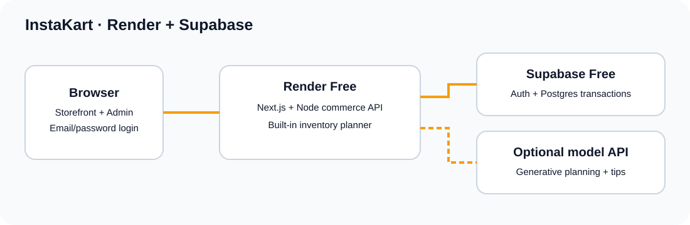

<div align="center">
  

# InstaKart

Situation-aware quick commerce on Render and Supabase.

Describe the moment. Compare three suggested carts. Check out essentials.

[Live App](https://instakart-nilay.onrender.com) · [Render dashboard](https://dashboard.render.com/web/srv-dc2l29cs728c73au35b0)
</div>

## Experience

- Text and browser voice input for situation-aware shopping.
- Fastest, Best Value, and Most Complete carts from live inventory.
- Email/password accounts, profile, persistent private carts, order history and tracking.
- Administrator inventory management, stock controls, analytics and business insights.
- Atomic checkout: locked stock validation, canonical catalog prices and order creation in one Postgres transaction.

The free deployment uses the built-in keyword/context planner. It supports explicit budgets and people counts without an external model account. Generative interpretation, generated tips and model-based insights can be enabled later with an OpenAI-compatible provider. This version has **no AWS runtime dependencies**.

Order placement and time-based delivery tracking are prototype workflows; the app does not charge cards or dispatch real deliveries.

## Architecture



| Component | Service |
| --- | --- |
| Storefront and administration | Next.js 16, React 19, Tailwind, Recharts |
| Frontend and API host | One Render Free Node.js web service |
| Authentication | Supabase Auth, email/password |
| Persistent storage | Supabase Postgres, `commerce_entities` JSON documents |
| Authorization | Server-verified Supabase users; admin role in trusted `app_metadata.groups` |
| Planning | Built-in inventory planner; optional OpenAI-compatible model |

The browser calls the same-origin `/api` endpoints. The server forwards each verified user session to Supabase. Row-level policies allow public catalog reads, private owner records and administrator inventory actions. Checkout calls a private transactional function that verifies `auth.uid()` and order ownership. Render needs only a publishable key; no Supabase service-role secret is used.

## Local development

Use Node.js 22.13 or newer within the 22.x line.

```sh
git clone https://github.com/nilaysrivastava/InstaKart.git
cd InstaKart
npm ci --prefix frontend
npm ci --prefix backend
cp frontend/.env.example frontend/.env.local
# Fill in the Supabase URL and publishable key.
npm run dev
```

Open [localhost:3000](http://localhost:3000). Run from the repository root so the custom server serves both the Next.js pages and commerce API.

For a fresh Supabase project, apply `backend/sql/schema.sql` and run the idempotent catalog seeder with an administrator access token and the public project configuration set:

```sh
SUPABASE_URL=... SUPABASE_PUBLISHABLE_KEY=... SUPABASE_ACCESS_TOKEN=... npm run seed --prefix backend
```

Existing products, administrator edits and stock levels are preserved by the seeder. The repository's 233 seed products start with quantity 100 unless otherwise specified. This deployment starts with a fresh catalog: historical AWS users/orders are not imported without access to the old services or an export.

## Render deployment

Use a **Free** Node web service with the repository root as its working directory:

| Setting | Value |
| --- | --- |
| Build | `npm run build` |
| Start | `npm start` |
| Health check | `/health` |
| Node | `22.x` |
| Region | Singapore |

Set these variables before building:

```env
NEXT_PUBLIC_SUPABASE_URL=https://YOUR_PROJECT.supabase.co
NEXT_PUBLIC_SUPABASE_PUBLISHABLE_KEY=YOUR_PUBLISHABLE_KEY
NEXT_PUBLIC_API_BASE_URL=/api
NODE_VERSION=22
```

Never put a secret key in a `NEXT_PUBLIC_` variable or a committed file. Public variables are compiled into browser code; changing them requires a rebuild.

In Supabase Auth, set the Site URL to the Render URL. Add the same URL and `http://localhost:3000` to the redirect allowlist. The sign-up dialog supports email OTP verification; configure the Confirm signup email template to include `{{ .Token }}`, or use the confirmation link and then sign in. Supabase's default email sender is restricted; configure a custom SMTP provider for unrestricted public signups.

The deployed service is linked through a public repository URL. Render currently requires a manual deploy after pushes for this source type, even when the service reports auto-deploy enabled. Use **Manual Deploy → Deploy latest commit** in its dashboard, or the Render plugin. Connect the GitHub provider in Render to enable push-triggered deploys.

### Administrators

Create a normal account, then use the Supabase Dashboard user editor or a server-only Auth Admin client to set:

```json
{"groups":["admin"]}
```

Set this in **app metadata**, never user metadata. Sign out and back in after assignment. Customers cannot grant themselves admin access. The backend verifies the current user with Supabase on every protected request.

### Optional generative AI

Set `AI_API_KEY`, `AI_BASE_URL` (an OpenAI-compatible API base), and `AI_MODEL` in Render, then redeploy. No key is needed for the built-in planner. Provider availability, free quotas and model names depend on your provider account. On provider failure the app falls back to inventory planning and rule-based insights.

## Routes and API

Pages: `/`, `/admin`, `/admin/inventory`.

| API route | Access |
| --- | --- |
| `GET /health`, `GET /api/health` | Public |
| `GET /api/now/products`, `POST /api/now/plan/guest` | Public |
| `POST /api/now/plan` | Customer |
| `GET/PUT/DELETE /api/now/cart` | Customer |
| `POST /api/now/checkout` | Customer |
| `GET /api/now/orders`, `GET /api/now/orders/{id}/track` | Owner |
| `POST /api/now/feedback` | Customer |
| `GET/POST /api/admin/inventory` | Admin |
| `PATCH/DELETE /api/admin/inventory/{id}` | Admin |
| `GET /api/admin/analytics`, `POST /api/admin/analytics/insights` | Admin |
| `/api/items`, `/api/ask`, `/api/now/seed`, `/api/now/embed-products` | Admin maintenance |

The legacy image-plan client helper had no corresponding backend route in the original app; image-based planning is not implemented.

## Validation

```sh
npm test --prefix backend
npm run lint --prefix frontend
npm run build --prefix frontend
npm audit --prefix frontend
npm audit --prefix backend
```

The backend tests exercise guest scenarios, budgets, people counts and unauthenticated access boundaries. Database integration validation checks canonical prices, stock deductions, oversell rejection and row-level database permissions. Database access tests simulate separate authenticated identities and roll back all fixtures. Live signed-in API tests verified authentication, carts, planning, feedback, administrator inventory creation, concurrent checkout and private order history. All 13 signed-in checks passed, including order tracking, disabled stock, inventory updates/deletion and administrator analytics/insights. Temporary fixtures were cleaned up.

## Free-plan operation

Render Free services sleep after 15 minutes idle and can take about a minute to wake up. Free hours are shared across your workspace's web services. Supabase Free projects may pause after inactivity. No paid database, worker, persistent disk or AI service is required. Usage is subject to each provider's included limits; see [Render Free](https://render.com/docs/free) and [Supabase pricing](https://supabase.com/pricing).

## Deployment verification — 24–25 November 2026

The service is live on the Render Free plan in Singapore. The Supabase project is `rapspqgzwtyfiabsyker` in Mumbai.

- Production build succeeded on Render, running Node.js 22.
- Catalog API returned all 233 seeded products.
- Guest recommendations passed three live scenarios, including a ₹500 cap and a group of four.
- Missing and forged tokens were rejected; customer and admin routes enforce authentication.
- Database tests verified private carts, prohibited inventory writes, canonical checkout prices, stock deduction, owner verification and oversell prevention.
- All 13 live checks passed using three temporary Supabase accounts: login, privilege-escalation rejection, private carts, cart clearing, owned plans, feedback, admin-only inventory creation, concurrent stock safety, canonical checkout prices/ETA, private order history, owner-only tracking, disabled stock enforcement, admin inventory update/deletion, analytics and business insights. Test accounts and records were removed afterward.
- The browser verified three cart modes and the sign-in prompt on a protected Add action.
- Backend tests and frontend lint passed; frontend/backend audits and Supabase security advisor reported no findings.

**Authentication configuration:** The production Site URL and redirect allowlist are configured for https://instakart-nilay.onrender.com.

**Signup email delivery is configured and verified:** Supabase Auth sends through Brevo Free SMTP (`smtp-relay.brevo.com`, port `587`). A real public signup using an owner-controlled Gmail plus-address succeeded, and the owner confirmed that the branded confirmation email arrived in the Inbox on 25 November 2026. The temporary signup account was removed and cleanup verified.

The confirmation email uses [`supabase/templates/confirmation.html`](supabase/templates/confirmation.html), with the subject **Confirm your InstaKart account**. It contains both the OTP used by the signup dialog and a confirmation link. Credentials are stored only in Supabase's SMTP settings.

No purchased domain is required for the current setup: the Brevo sender is verified by email, and Brevo rewrites the From address to a compliant managed address for freemail senders. Brevo documents this as a temporary compatibility measure; see [sender requirements](https://help.brevo.com/hc/en-us/articles/14925263522578). The [Free SMTP plan](https://www.brevo.com/free-smtp-server/) currently allows 300 emails/day. Check key expiry in Brevo when maintaining the service; its key-generation screen also states that keys expire after 90 days of inactivity. Rotate SMTP credentials directly in Supabase, never in public source or browser environment variables.

No permanent administrator account has been assigned; the owner can sign up and use the administrator setup instructions above. Generative AI is intentionally deferred; the live app uses its built-in planner.
